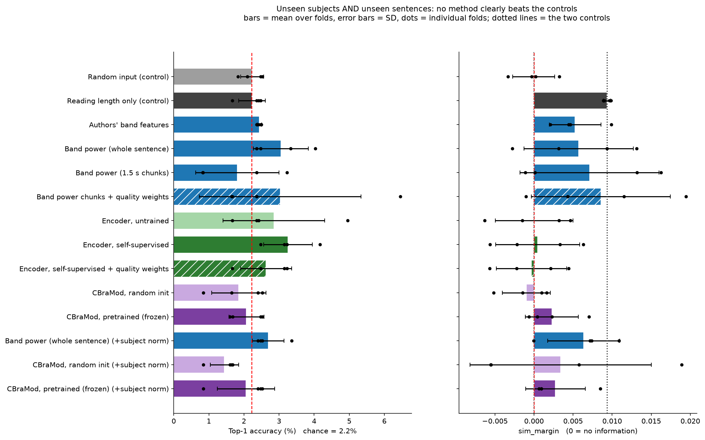

**Results with figures: [RESULTS.md](RESULTS.md)**
# EEG Representation Learning for Brain Signal Decoding

Does EEG recorded while people read sentences carry information about *which* sentence they read? This project tests that on the ZuCo 1.0 and ZuCo 2.0 datasets with sentence retrieval. It compares a handcrafted band-power baseline, a frozen pretrained EEG encoder (CBraMod) and a self-supervised encoder trained on ZuCo. Evaluation uses unseen subjects and unseen sentences, noise and quality experiments, cross-dataset transfer, and random-input and reading-behaviour controls.

**Main finding (negative result).** Under unseen-subject, unseen-sentence evaluation, EEG-based sentence retrieval is at chance level and indistinguishable from random input. This holds for band-power features, the datasets' own features, a self-supervised encoder trained on ZuCo, and the frozen pretrained CBraMod encoder, including under added noise and in transfer between the two datasets. The only signal above chance comes from reading length/time, which carries no sentence meaning. A positive control shows the pipeline *can* detect real EEG information: first-fixation duration is predictable from per-word EEG features (within-subject r = 0.146), but word length and sentence content are not. A word-level GRU shows that reading behaviour alone (fixation time + word length, no EEG) beats random input, and EEG does not add to it. See `reports/final_report.md`.

## Repository layout

- `src/eegdecode/` - metrics, subject/sentence splits with leakage checks, band-power features, ridge alignment, sentence embeddings, EEG loading
- `scripts/` - one script per step (`download_zuco.py`, `build_dataset.py`, `align_windows.py`, `run_experiments.py`, `run_transfer.py`, `make_cache.py`, `run_groundtruth.py`, `run_final.py`, `run_words.py`, `run_positive_control.py`, `smoke_cbramod.py`, `run_cbramod.py`, `run_gru.py`, `make_report.py`)
- Earlier scripts kept for the record: `run_pretrained.py` and `run_transfer_encoders.py` produced `results_pretrained.csv`, `results_robust_ssl.csv` and `results_transfer_encoders.csv` (continuous windows with inferred alignment). They import `run_robust_ssl.py`, which is no longer in the repository, so they cannot be rerun; the CSVs are kept. `make_figures.py` is superseded by `make_report.py`. `run_inspect.py` and `run_probe.py` are small data-inspection helpers (`reports/probe_matlab_zab.txt` is the output of the Matlab-file probe for subject ZAB).
- `tests/` - 39 tests (metrics, split integrity, leakage detector, a synthetic retrieval test with a noise-input control, loaders, encoder checkpoint)
- `experiments/results/` - result CSVs and figures
- `RESULTS.md` - generated results page with figures (`python scripts\make_report.py`)
- `reports/final_report.md` - methods, results, limitations

## Setup (Windows)

```powershell
python -m venv .venv
.venv\Scripts\Activate.ps1
pip install -e ".[dev]"
pip install sentence-transformers matplotlib osfclient
pytest -q
```

CBraMod is loaded through `braindecode` (Hugging Face weights `braindecode/cbramod-pretrained`). Google Colab: clone the repo, then run `!pip install -e ".[dev]" sentence-transformers matplotlib osfclient` and call the scripts with `!python scripts/<name>.py`. A GPU is used automatically by `run_final.py` if available; the CPU is enough.

## Data (not included in this repository)

- ZuCo 1.0: https://osf.io/q3zws/ - ZuCo 2.0: https://osf.io/2urht/
- The data are **not** redistributed here. Check the licence and terms on each OSF page before using or sharing them.
- Used: preprocessed natural-reading (NR) EEG, ZuCo 1.0 (12 subjects) and 8 of the 18 ZuCo 2.0 subjects, plus the ZuCo 1.0 "Matlab files" (about 10 GB), which give the true sentence for every EEG row.

## Reproduce

```powershell
# 1. download (data go to data\raw, which is git-ignored)
python scripts\download_zuco.py --project 2urht --task "task1 - NR" --out data\raw\zuco2 --areas Preprocessed task_materials --subjects YAC YAG YAK YDG YDR YFR YFS YHS --no-et
python scripts\download_zuco.py --project q3zws --task "task2 - NR" --out data\raw\zuco1 --areas Preprocessed task_materials --no-et
python scripts\download_zuco.py --project q3zws --task "task2 - NR" --out data\raw\zuco1 --areas "Matlab files"

# 2. continuous-EEG experiments (windows from triggers 10->11, aligned to sentences by order and duration)
python scripts\build_dataset.py        # see --help for options
python scripts\align_windows.py
python scripts\run_experiments.py --regime double
python scripts\run_experiments.py --regime subject_only
python scripts\run_experiments.py --regime double --subject-norm
python scripts\run_transfer.py

# 3. true-label experiments (ZuCo 1.0 Matlab files)
python scripts\make_cache.py
python scripts\run_final.py
python scripts\run_words.py
python scripts\run_positive_control.py

# 4. pretrained encoder (CBraMod) and word-level GRU
python scripts\smoke_cbramod.py
python scripts\run_cbramod.py extract
python scripts\run_cbramod.py eval
python scripts\run_gru.py

# 5. generate RESULTS.md and figures
python scripts\make_report.py
```

## Results (numbers from the saved CSVs in `experiments/results/metrics`)

Evaluation: unseen subjects **and** unseen sentences (4 leave-subjects-out folds, leakage checked on every fold); candidates = the unique test sentences; metric `sim_margin` = mean cosine similarity of the correct sentence minus the others (0 = chance; random input is about 0).

**Main table - ZuCo 1.0, 12 subjects, true sentence labels, 45 candidates per fold (chance top-1 = 2.2%, chance MRR = 0.098)**

| Method (clean EEG) | top-1 | MRR | sim_margin (SD over folds) |
|---|---|---|---|
| Random input (control) | 2.2% | 0.098 | 0.0000 (0.0027) |
| Reading length only (control, no EEG) | 2.2% | 0.104 | 0.0093 (0.0005) |
| Authors' band features | 2.4% | 0.103 | 0.0053 (0.0033) |
| Our band power (whole sentence) | 3.1% | 0.110 | 0.0057 (0.0070) |
| Band power of 1.5 s chunks | 1.8% | 0.103 | 0.0071 (0.0089) |
| ... with quality weighting | 3.0% | 0.113 | 0.0086 (0.0089) |
| Self-supervised encoder (trained on ZuCo, no labels) | 3.3% | 0.107 | 0.0005 (0.0054) |
| Same encoder, untrained | 2.9% | 0.102 | 0.0000 (0.0050) |

No EEG method beats the random-input control and the reading-length control by more than the spread across folds.

**Pretrained encoder (CBraMod, frozen), same folds.** This evaluation used its own row set (3,266 sentence rows), so the control numbers differ slightly from the table above; compare methods within this table only. It used clean EEG only; noise for CBraMod is in the next table.

| Method | top-1 | MRR | sim_margin (SD over folds) |
|---|---|---|---|
| Random input (control) | 1.94% | 0.0981 | -0.0010 (0.0019) |
| Reading length only (control, no EEG) | 2.27% | 0.1033 | 0.0086 (0.0008) |
| Authors' band features | 2.68% | 0.1037 | 0.0056 (0.0036) |
| Our band power | 2.28% | 0.1020 | 0.0052 (0.0056) |
| Our band power + per-subject norm | 2.69% | 0.1044 | 0.0063 (0.0046) |
| **CBraMod, pretrained (frozen)** | 2.07% | 0.1026 | 0.0023 (0.0034) |
| CBraMod, pretrained + per-subject norm | 2.06% | 0.1034 | 0.0028 (0.0038) |
| CBraMod, random init | 1.85% | 0.0937 | -0.0010 (0.0031) |
| CBraMod, random init + per-subject norm | 1.44% | 0.0911 | 0.0034 (0.0116) |

Chance is 2.22% top-1 and 0.0977 MRR. Frozen pretrained CBraMod is at chance and no better than band power or the no-EEG reading-length control. The "per-subject norm" rows are transductive (see Limitations).

**CBraMod under added noise and quality weighting (earlier run on the continuous windows, sentence alignment inferred; 4 folds; unseen subjects and sentences).** `sim_margin`, mean (SD over folds). Noise = 0 / 0.5 / 1 / 2 x each channel's standard deviation, added to the test EEG. Chance top-1 is 2.6% (ZuCo 1.0) and 2.5% (ZuCo 2.0). This file has no reading-length control row.

| Dataset | Method | clean | mild | moderate | strong |
|---|---|---|---|---|---|
| ZuCo 1.0 | CBraMod, frozen | 0.0033 (0.0068) | 0.0025 (0.0066) | 0.0015 (0.0041) | -0.0001 (0.0029) |
| ZuCo 1.0 | CBraMod, frozen + quality weights | 0.0033 (0.0053) | 0.0029 (0.0051) | 0.0011 (0.0025) | -0.0006 (0.0023) |
| ZuCo 1.0 | CBraMod, untrained | -0.0019 (0.0047) | | | |
| ZuCo 1.0 | Random input | -0.0012 (0.0029) | | | |
| ZuCo 2.0 | CBraMod, frozen | 0.0061 (0.0038) | 0.0089 (0.0064) | 0.0047 (0.0031) | 0.0015 (0.0013) |
| ZuCo 2.0 | CBraMod, frozen + quality weights | -0.0037 (0.0075) | -0.0001 (0.0071) | 0.0007 (0.0063) | -0.0012 (0.0050) |
| ZuCo 2.0 | CBraMod, untrained | 0.0059 (0.0062) | | | |
| ZuCo 2.0 | Random input | -0.0023 (0.0063) | | | |

Frozen CBraMod's `sim_margin` drifts toward 0 at strong noise in both datasets, but its clean values are already within the fold-to-fold spread of 0, so this is not evidence of real information being lost. In ZuCo 2.0 the frozen CBraMod (0.0061) is above random input (-0.0023), but the same network untrained gets 0.0059, so pretraining does not explain it; treat it as exploratory, not a finding. Quality weighting gives no gain for CBraMod. In the same earlier run the self-supervised encoder was not better than the untrained one (clean `sim_margin`: ZuCo 1.0 0.0035 vs 0.0056; ZuCo 2.0 -0.0045 vs -0.0034).

**Word-level GRU and the reading-behaviour control** (12 subjects, 4 folds, unseen sentences, 45 candidates; MRR above chance, mean over test subjects with 95% bootstrap CI over subjects; one seed)

| Input per word | MRR above chance [95% CI] |
|---|---|
| Random numbers | 0.0015 [-0.0080, 0.0114] |
| Reading behaviour only (first-fixation time + word length, no EEG) | 0.0803 [0.0623, 0.0964] |
| EEG, train-statistics normalisation | 0.0035 [-0.0057, 0.0155] |
| EEG, per-subject normalisation (transductive) | 0.0174 [-0.0061, 0.0425] |
| EEG + behaviour, train-statistics normalisation | -0.0014 [-0.0088, 0.0059] |
| EEG + behaviour, per-subject normalisation (transductive) | 0.0260 [0.0091, 0.0441] |

Paired differences (MRR, bootstrap over subjects): honest EEG minus random input = +0.0020 [-0.0121, 0.0183]. Per-subject-normalised EEG minus behaviour-only = -0.0629 [-0.0925, -0.0296]. Per-subject-normalised EEG + behaviour minus behaviour-only = -0.0543 [-0.0734, -0.0338]. Decision rule fixed in advance: an EEG model counts as a real finding only if its paired difference against both random input and the behaviour-only control is entirely above 0. No EEG model meets it. Reading behaviour alone is clearly above random input.

**Noise added to the test EEG** (`sim_margin`; noise = 0 / 0.5 / 1 / 2 x each channel's own standard deviation; true-label experiment)

| Method | clean | mild | moderate | strong |
|---|---|---|---|---|
| Band power of chunks | 0.0071 | -0.0017 | 0.0031 | 0.0044 |
| Self-supervised encoder | 0.0005 | 0.0003 | 0.0004 | -0.0007 |

Curves are flat because there is no sentence information to degrade.

**Other experiments** (top-1 for EEG / random input / duration shortcut / chance)

| Experiment | Candidates | EEG | Random | Duration | Chance |
|---|---|---|---|---|---|
| ZuCo 1.0 continuous windows, unseen subjects + sentences | 39 | 2.8% | 2.5% | 3.7% | 2.6% |
| ZuCo 2.0 (8 subjects), same | 44 | 2.0% | 1.8% | 1.4% | 2.3% |
| Transfer ZuCo 1.0 -> 2.0 (source-only decoder, unseen sentences) | 259 | 0.48% | 0.34% | 0.34% | 0.39% |
| Transfer ZuCo 2.0 -> 1.0 | 226 | 0.53% | 0.42% | 0.45% | 0.44% |

**Transfer with the encoders (earlier run, source-only decoder, unseen target sentences, single run per row except where `runs` > 1).** This is a separate run from the transfer rows above, so candidate counts and numbers differ slightly.

| Direction | Method | runs | top-1 | chance top-1 | MRR | chance MRR | sim_margin |
|---|---|---|---|---|---|---|---|
| ZuCo 1.0 -> 2.0 (255 candidates) | Band power | 1 | 0.35% | 0.39% | 0.0244 | 0.0240 | 0.0010 |
| | CBraMod, frozen | 1 | 0.17% | 0.39% | 0.0215 | 0.0240 | -0.0022 |
| | CBraMod, untrained | 1 | 0.23% | 0.39% | 0.0219 | 0.0240 | -0.0025 |
| | Self-supervised encoder | 4 | 0.39% | 0.39% | 0.0229 | 0.0240 | -0.0022 |
| | Encoder, untrained | 4 | 0.39% | 0.39% | 0.0226 | 0.0240 | -0.0022 |
| | Random input | 3 | 0.42% | 0.39% | 0.0230 | 0.0240 | -0.0031 |
| ZuCo 2.0 -> 1.0 (226 candidates) | Band power | 1 | 0.63% | 0.44% | 0.0293 | 0.0265 | 0.0032 |
| | CBraMod, frozen | 1 | 0.12% | 0.44% | 0.0232 | 0.0265 | -0.0013 |
| | CBraMod, untrained | 1 | 0.27% | 0.44% | 0.0237 | 0.0265 | -0.0007 |
| | Self-supervised encoder | 4 | 0.32% | 0.44% | 0.0251 | 0.0265 | -0.0007 |
| | Encoder, untrained | 4 | 0.24% | 0.44% | 0.0240 | 0.0265 | -0.0012 |
| | Random input | 3 | 0.37% | 0.44% | 0.0258 | 0.0265 | 0.0002 |

No encoder transfers between datasets: all are at or below chance, and the frozen CBraMod is not better than its untrained version. Band power in ZuCo 2.0 -> 1.0 is slightly above chance (0.63% vs 0.44%) from a single run; the other direction is at chance, so I do not count it.

**Positive control** (Pearson r on held-out rows; ZuCo 1.0, 48,638 word rows): EEG features predict log first-fixation duration within a subject (r = 0.146, SD 0.072 over 12 subjects; random features 0.012), and across subjects only after per-subject standardization (r = 0.082; raw features -0.031). They do not predict word length (r about 0.008). Word-level retrieval and sentence retrieval from word-level EEG are at the random-input level (sentence MRR 0.094 vs 0.095 random vs 0.098 chance).



## Limitations

- Sentence-level and first-fixation band features only; no time-locked word-level (ERP-style) decoding. This is the main untested direction.
- 4 folds and one seed. Bootstrap confidence intervals over subjects exist only for the GRU comparison; no significance tests and no multiple-comparison correction. Small differences are within the spread across folds.
- Per-subject standardization uses unlabeled test-subject EEG (transductive) and is reported separately.
- Noise is synthetic white noise; the quality indicator is a simple artifact fraction. In the true-label experiment CBraMod was evaluated on clean EEG only; its noise results come from the earlier continuous-window run, which has inferred alignment and no reading-length control row.
- CBraMod was pretrained on 19-channel 10-20 recordings, and ZuCo has 104 EGI channels, so the montage mismatch may weaken it. It was used frozen and not fine-tuned.
- ZuCo 2.0 uses 8 of 18 subjects and the preprocessed continuous recordings, so its sentence alignment is inferred from window durations (per-subject Spearman with sentence length: median 0.83 for ZuCo 1.0 and 0.71 for ZuCo 2.0, about 0 for shuffled sentences). In ZuCo 1.0 these windows covered 264 of 300 sentences; the reason is not investigated. The ZuCo 2.0 Matlab files (34.6 GB) were not downloaded.
- The self-supervised encoder is small and untuned (8 epochs).
- The earlier-run results (CBraMod noise, encoder transfer) were produced by scripts that can no longer be rerun, and they are not part of the generated `RESULTS.md`.
- Word retrieval "chance" is not meaningful because frequent words dominate the candidates; compare against the random-input control.

## References

ZuCo, a simultaneous EEG and eye-tracking resource for natural sentence reading (ZuCo 1.0); ZuCo 2.0: A Dataset of Physiological Recordings During Natural Reading and Annotation (arXiv:1912.00903); Are EEG-to-Text Models Working? (arXiv:2405.06459), which motivates the random-noise control used here; CBraMod (ICLR 2025).