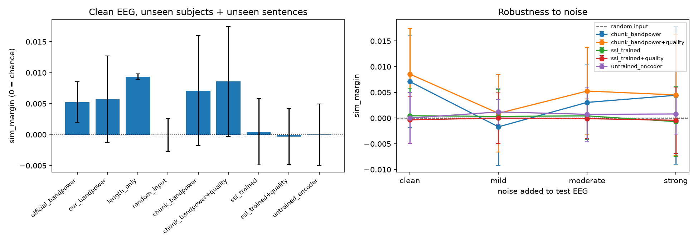

**Results with figures: [RESULTS.md](RESULTS.md)**
# EEG Representation Learning for Brain Signal Decoding

Does EEG recorded while people read sentences carry information about *which* sentence they read? This project tests that on the ZuCo 1.0 and ZuCo 2.0 datasets with sentence retrieval, using a handcrafted baseline and a self-supervised encoder, unseen-subject and unseen-sentence evaluation, noise and quality experiments, cross-dataset transfer, and random-input and reading-length controls.

**Main finding (negative result).** Under unseen-subject, unseen-sentence evaluation, EEG-based sentence retrieval is at chance level and indistinguishable from random input, for band-power features, the datasets' own features, and a self-supervised encoder trained on ZuCo. The only signal above chance comes from reading length/time, which carries no sentence meaning. A positive control shows the pipeline *can* detect real EEG information: first-fixation duration is predictable from per-word EEG features (within-subject r = 0.146), but word length and sentence content are not. See `reports/final_report.md`.

## Repository layout

- `src/eegdecode/` - metrics, subject/sentence splits with leakage checks, band-power features, ridge alignment, sentence embeddings, EEG loading
- `scripts/` - one script per step (`download_zuco.py`, `build_dataset.py`, `align_windows.py`, `run_experiments.py`, `run_transfer.py`, `make_cache.py`, `run_groundtruth.py`, `run_final.py`, `run_words.py`, `run_positive_control.py`)
- `tests/` - 38 tests (metrics, split integrity, leakage detector, a synthetic retrieval test with a noise-input control, loaders)
- `experiments/results/` - result CSVs and figures
- `reports/final_report.md` - methods, results, limitations

## Setup (Windows)

```powershell
python -m venv .venv
.venv\Scripts\Activate.ps1
pip install -e ".[dev]"
pip install sentence-transformers matplotlib osfclient
pytest -q
```

Google Colab: clone the repo, then run `!pip install -e ".[dev]" sentence-transformers matplotlib osfclient` and call the scripts with `!python scripts/<name>.py`. A GPU is used automatically by `run_final.py` if available; the CPU is enough.

## Data (not included in this repository)

- ZuCo 1.0: https://osf.io/q3zws/ - ZuCo 2.0: https://osf.io/2urht/
- The data are **not** redistributed here. Check the licence and terms on each OSF page before using or sharing them.
- Used: preprocessed natural-reading (NR) EEG, ZuCo 1.0 (12 subjects) and 8 of the 18 ZuCo 2.0 subjects, plus the ZuCo 1.0 "Matlab files" (about 10 GB), which give the true sentence for every EEG row.

## Reproduce

```powershell
# 1. download (data go to data\raw, which is git-ignored)
python scripts\download_zuco.py --project 2urht --task "task1 - NR" --out data\raw\zuco2 --areas Preprocessed task_materials --subjects YAC YAG YAK YDG YDR YFR YFS YHS --no-et
python scripts\download_zuco.py --project q3zws --task "task2 - NR" --out data\raw\zuco1 --areas Preprocessed task_materials --no-et
python scripts\download_zuco.py --project q3zws --task "task2 - NR" --out data\raw\zuco1 --areas "Matlab files"

# 2. continuous-EEG experiments (windows from triggers 10->11, aligned to sentences by order and duration)
python scripts\build_dataset.py        # see --help for options
python scripts\align_windows.py
python scripts\run_experiments.py --regime double
python scripts\run_experiments.py --regime subject_only
python scripts\run_experiments.py --regime double --subject-norm
python scripts\run_transfer.py

# 3. true-label experiments (ZuCo 1.0 Matlab files)
python scripts\make_cache.py
python scripts\run_final.py
python scripts\run_words.py
python scripts\run_positive_control.py
```

## Results (all numbers from the saved CSVs in `experiments/results/metrics`)

Evaluation: unseen subjects **and** unseen sentences (4 leave-subjects-out folds, leakage checked on every fold); candidates = the unique test sentences; metric `sim_margin` = mean cosine similarity of the correct sentence minus the others (0 = chance; random input is about 0).

**Main table - ZuCo 1.0, 12 subjects, true sentence labels, 45 candidates per fold (chance top-1 = 2.2%, chance MRR = 0.098)**

| Method (clean EEG) | top-1 | MRR | sim_margin (SD over folds) |
|---|---|---|---|
| Random input (control) | 2.2% | 0.098 | 0.0000 (0.0027) |
| Reading length only (control, no EEG) | 2.2% | 0.104 | 0.0093 (0.0005) |
| Authors' band features | 2.4% | 0.103 | 0.0053 (0.0033) |
| Our band power (whole sentence) | 3.1% | 0.110 | 0.0057 (0.0070) |
| Band power of 1.5 s chunks | 1.8% | 0.103 | 0.0071 (0.0089) |
| ... with quality weighting | 3.0% | 0.113 | 0.0086 (0.0089) |
| Self-supervised encoder (trained on ZuCo, no labels) | 3.3% | 0.107 | 0.0005 (0.0054) |
| Same encoder, untrained | 2.9% | 0.102 | 0.0000 (0.0050) |

No EEG method beats the random-input control and the reading-length control by more than the spread across folds.

**Noise added to the test EEG** (`sim_margin`; noise = 0 / 0.5 / 1 / 2 x each channel's own standard deviation)

| Method | clean | mild | moderate | strong |
|---|---|---|---|---|
| Band power of chunks | 0.0071 | -0.0017 | 0.0031 | 0.0044 |
| Self-supervised encoder | 0.0005 | 0.0003 | 0.0004 | -0.0007 |

Curves are flat because there is no sentence information to degrade.

**Other experiments** (top-1 for EEG / random input / duration shortcut / chance)

| Experiment | Candidates | EEG | Random | Duration | Chance |
|---|---|---|---|---|---|
| ZuCo 1.0 continuous windows, unseen subjects + sentences | 39 | 2.8% | 2.5% | 3.7% | 2.6% |
| ZuCo 2.0 (8 subjects), same | 44 | 2.0% | 1.8% | 1.4% | 2.3% |
| Transfer ZuCo 1.0 -> 2.0 (source-only decoder, unseen sentences) | 259 | 0.48% | 0.34% | 0.34% | 0.39% |
| Transfer ZuCo 2.0 -> 1.0 | 226 | 0.53% | 0.42% | 0.45% | 0.44% |

**Positive control** (Pearson r on held-out rows; ZuCo 1.0, 48,638 word rows): EEG features predict log first-fixation duration within a subject (r = 0.146, SD 0.072 over 12 subjects; random features 0.012), and across subjects only after per-subject standardization (r = 0.082; raw features -0.031). They do not predict word length (r about 0.008). Word-level retrieval and sentence retrieval from word-level EEG are at the random-input level (sentence MRR 0.094 vs 0.095 random vs 0.098 chance).



## Limitations

- Sentence-level and first-fixation band features only; no time-resolved word-level decoding.
- Few folds (4), no subject-level bootstrap confidence intervals, no significance tests; small differences are within the spread across folds.
- Per-subject standardization uses unlabeled test-subject EEG (transductive) and is reported separately.
- Noise is synthetic white noise; the quality indicator is a simple artifact fraction.
- ZuCo 2.0 uses 8 of 18 subjects and the preprocessed continuous recordings, so its sentence alignment is inferred from window durations (per-subject Spearman with sentence length: median 0.83 for ZuCo 1.0 and 0.71 for ZuCo 2.0, about 0 for shuffled sentences). In ZuCo 1.0 these windows covered 264 of 300 sentences; the reason is not investigated.
- The self-supervised encoder is small and untuned (8 epochs); no pretrained EEG encoder was run because I did not find and verify a public model that accepts this 104-channel data.
- Word retrieval "chance" is not meaningful because frequent words dominate the candidates; compare against the random-input control.

## References

ZuCo, a simultaneous EEG and eye-tracking resource for natural sentence reading (ZuCo 1.0); ZuCo 2.0: A Dataset of Physiological Recordings During Natural Reading and Annotation (arXiv:1912.00903); Are EEG-to-Text Models Working? (arXiv:2405.06459), which motivates the random-noise control used here.
