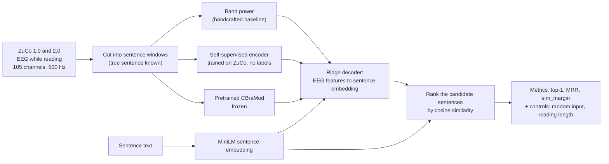
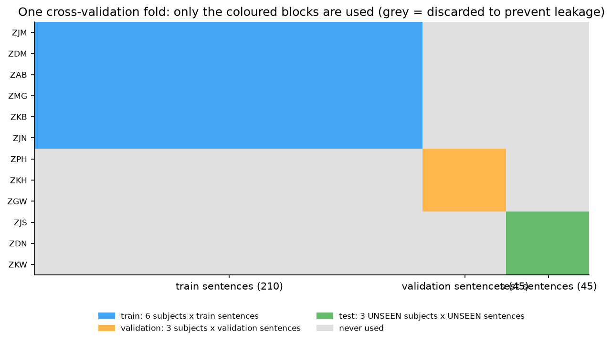
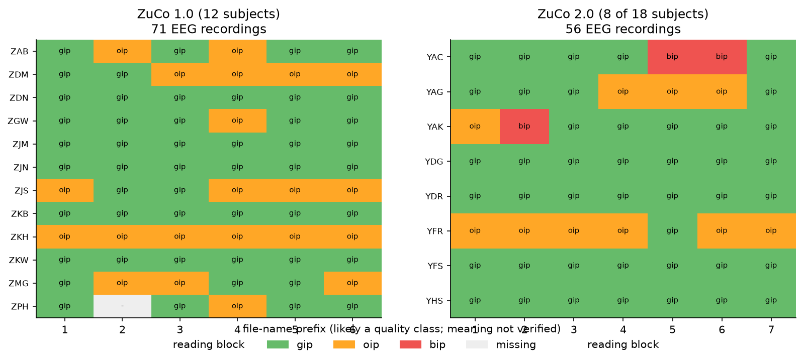
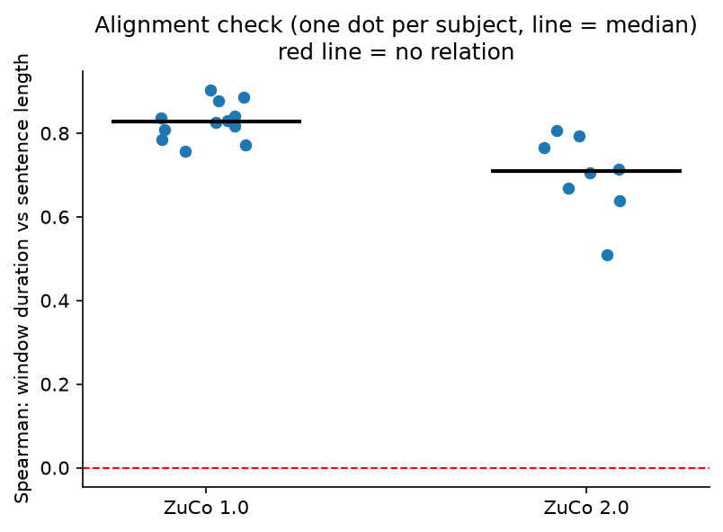
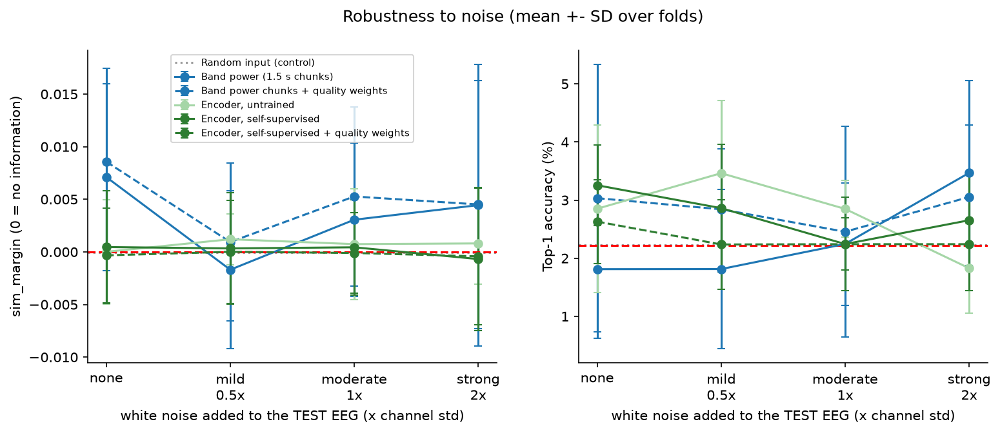
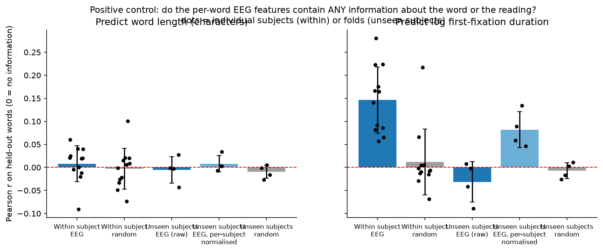
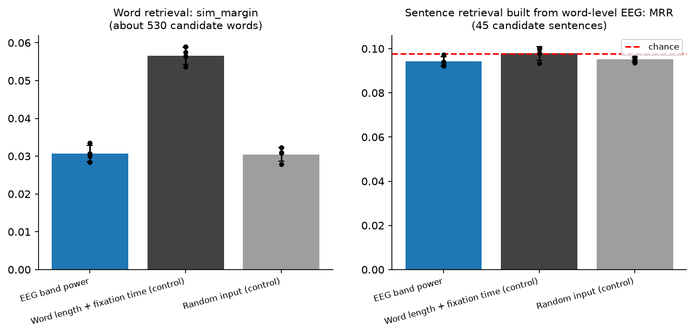
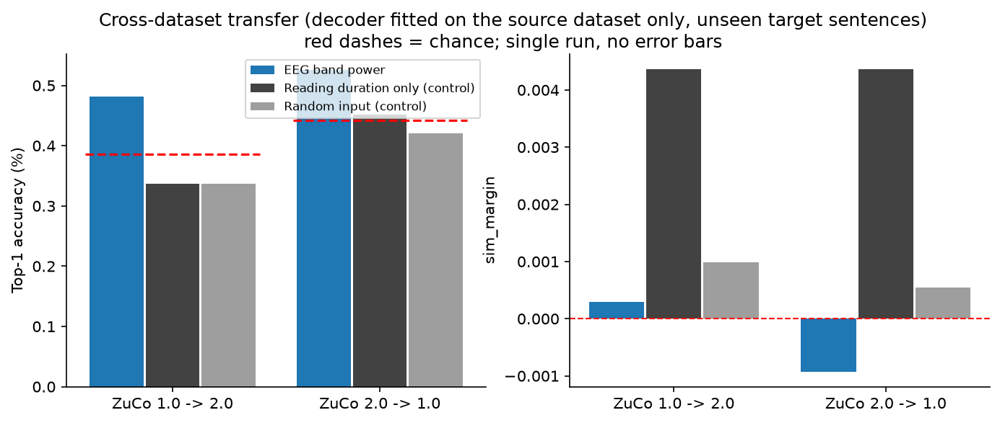
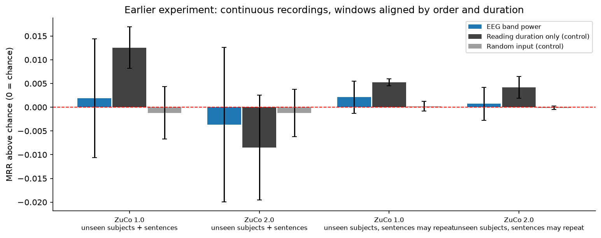

# Results: does EEG carry information about the sentence being read?

ZuCo 1.0 and ZuCo 2.0. Every number and figure below is generated from the saved result files by `scripts/make_report.py`.

**Question.** While a person reads a sentence, does their EEG contain information about *which* sentence it is? We tested this with sentence retrieval under a strict protocol, with controls that a real effect must beat.

**Answer in one line.** No. None of the EEG representations (handcrafted band power, a self-supervised encoder trained on ZuCo, frozen pretrained CBraMod) beats both a random-input control and a reading-length control on unseen subjects and unseen sentences. What the EEG features do contain is reading-related information (fixation duration), not sentence content.

## 1. The pipeline

## 2. How we test it, and why it is strict

- **Unseen subjects:** whole people are held out, so the decoder never saw the test person's EEG.
- **Unseen sentences:** the test sentences never appear in training either (otherwise a model could memorise sentences).
- **Candidates and chance:** for each test EEG the decoder ranks 45 candidate sentences, so guessing gets top-1 = 1/45 = 2.2%.
- **Metrics:** *top-1* = the correct sentence is ranked first; *MRR* = average of 1/rank of the correct sentence; *sim_margin* = similarity of the decoded vector to the correct sentence minus to the other sentences (0 = no information, and it detects weak effects that top-1 misses).
- **Controls:** (1) random numbers through the identical pipeline; (2) reading length only (number of samples and words, no brain signal). A real effect must beat both.
- **Folds:** 4 leave-subjects-out folds; error bars are the SD across folds; no significance tests.

## 3. The data

| Dataset | Subjects | EEG recordings | Sentence windows |
|---|---|---|---|
| ZuCo 1.0 | 12 | 71 | 3125 |
| ZuCo 2.0 (8 of 18 subjects) | 8 | 56 | 2424 |

For the continuous recordings, windows were matched to sentences by order and duration (the sentence is *inferred*). Check: reading duration should grow with sentence length.

Median per-subject Spearman: ZuCo 1.0 = 0.83; ZuCo 2.0 = 0.71. The true-label experiments use ZuCo 1.0's 'Matlab files' (12 subjects, about 300 sentences each), where the sentence is given.

## 4. Main result

| Method | Top-1 % | Chance % | MRR | Chance MRR | sim_margin (SD over folds) | Beats both controls? |
|---|---|---|---|---|---|---|
| Random input (control) | 2.2 | 2.2 | 0.098 | 0.098 | -0.0000 (0.0027) | control |
| Reading length only (control) | 2.2 | 2.2 | 0.104 | 0.098 | 0.0093 (0.0005) | control |
| Authors' band features | 2.4 | 2.2 | 0.103 | 0.098 | 0.0053 (0.0033) | no |
| Band power (whole sentence) | 3.1 | 2.2 | 0.110 | 0.098 | 0.0057 (0.0070) | no |
| Band power (1.5 s chunks) | 1.8 | 2.2 | 0.103 | 0.098 | 0.0071 (0.0089) | no |
| Band power chunks + quality weights | 3.0 | 2.2 | 0.113 | 0.098 | 0.0086 (0.0089) | no |
| Encoder, untrained | 2.9 | 2.2 | 0.102 | 0.098 | 0.0000 (0.0050) | no |
| Encoder, self-supervised | 3.3 | 2.2 | 0.107 | 0.098 | 0.0005 (0.0054) | no |
| Encoder, self-supervised + quality weights | 2.6 | 2.2 | 0.103 | 0.098 | -0.0003 (0.0045) | no |
| CBraMod, random init | 1.9 | 2.2 | 0.094 | 0.098 | -0.0010 (0.0031) | no |
| CBraMod, pretrained (frozen) | 2.1 | 2.2 | 0.103 | 0.098 | 0.0023 (0.0034) | no |
| Band power (whole sentence) (+subject norm) | 2.7 | 2.2 | 0.104 | 0.098 | 0.0063 (0.0046) | no |
| CBraMod, random init (+subject norm) | 1.4 | 2.2 | 0.091 | 0.098 | 0.0034 (0.0116) | no |
| CBraMod, pretrained (frozen) (+subject norm) | 2.1 | 2.2 | 0.103 | 0.098 | 0.0028 (0.0038) | no |

*Beats both controls?* is a conservative rule of thumb, not a significance test: the method's mean `sim_margin` must exceed the larger control mean by more than its own SD across folds.

**Does pretraining matter?** CBraMod pretrained `sim_margin` = 0.0023 vs the same network randomly initialised = -0.0010 (random input = -0.0000).

**Does self-supervised learning matter?** Trained encoder `sim_margin` = 0.0005 vs untrained = 0.0000.

## 5. Noise and signal quality

White noise was added to the **test** EEG only, at 0.5, 1 and 2 times each channel's own standard deviation (about 6 dB, 0 dB and -6 dB signal-to-noise). *Quality weighting* gives training rows with many artifacts a smaller weight.

| Method (sim_margin) | none | mild | moderate | strong |
|---|---|---|---|---|
| Band power (1.5 s chunks) | 0.0071 | -0.0017 | 0.0031 | 0.0044 |
| Band power chunks + quality weights | 0.0086 | 0.0009 | 0.0053 | 0.0045 |
| Encoder, untrained | 0.0000 | 0.0012 | 0.0007 | 0.0008 |
| Encoder, self-supervised | 0.0005 | 0.0003 | 0.0004 | -0.0007 |
| Encoder, self-supervised + quality weights | -0.0003 | 0.0000 | -0.0001 | -0.0004 |

There is no systematic decline with noise: a representation with no sentence information has nothing to lose. Quality weighting makes no reliable difference either.

## 6. What the EEG features do contain (positive control)

A negative result is only convincing if the pipeline can detect a real effect. We asked whether the per-word EEG features predict simple word properties on held-out words.

- Within one person, EEG predicts log first-fixation duration (r = 0.146 vs 0.012 for random features).
- Across people it only appears after per-subject normalisation (r = 0.082; raw -0.031). That normalisation uses unlabeled test-subject EEG (transductive).
- Word length is not predicted (r = 0.008 within subject).
- Fixation duration is an eye-movement / reading-time quantity, so this is reading-related information, not sentence meaning.

Word-level retrieval and sentence retrieval from word-level EEG:

Word retrieval `sim_margin`: EEG 0.0307, random input 0.0305, word length + fixation time 0.0566. Sentence MRR from word EEG: EEG 0.094, random 0.095, chance 0.098. (Word-retrieval chance is not meaningful because frequent words dominate; compare with the random-input control.)

## 7. Transfer between ZuCo 1.0 and ZuCo 2.0

The decoder is fitted on the source dataset only (no target labels) and tested on target sentences it never saw. The two datasets share the same 105 channels in the same order, so no channel mapping was needed.

| Direction | Per-subject norm? | Condition | Candidates | Top-1 % | Chance % | MRR | sim_margin |
|---|---|---|---|---|---|---|---|
| ZuCo 1.0 -> ZuCo 2.0 | no | EEG band power | 259 | 0.48 | 0.39 | 0.0244 | 0.0003 |
| ZuCo 1.0 -> ZuCo 2.0 | no | Reading duration only (control) | 259 | 0.34 | 0.39 | 0.0252 | 0.0044 |
| ZuCo 1.0 -> ZuCo 2.0 | no | Random input (control) | 259 | 0.34 | 0.39 | 0.0229 | 0.0010 |
| ZuCo 2.0 -> ZuCo 1.0 | no | EEG band power | 226 | 0.53 | 0.44 | 0.0266 | -0.0009 |
| ZuCo 2.0 -> ZuCo 1.0 | no | Reading duration only (control) | 226 | 0.45 | 0.44 | 0.0294 | 0.0044 |
| ZuCo 2.0 -> ZuCo 1.0 | no | Random input (control) | 226 | 0.42 | 0.44 | 0.0263 | 0.0006 |
| ZuCo 1.0 -> ZuCo 2.0 | yes | EEG band power | 259 | 0.29 | 0.39 | 0.0225 | 0.0008 |
| ZuCo 1.0 -> ZuCo 2.0 | yes | Reading duration only (control) | 259 | 0.34 | 0.39 | 0.0252 | 0.0044 |
| ZuCo 1.0 -> ZuCo 2.0 | yes | Random input (control) | 259 | 0.34 | 0.39 | 0.0229 | 0.0010 |
| ZuCo 2.0 -> ZuCo 1.0 | yes | EEG band power | 226 | 0.49 | 0.44 | 0.0267 | -0.0020 |
| ZuCo 2.0 -> ZuCo 1.0 | yes | Reading duration only (control) | 226 | 0.45 | 0.44 | 0.0294 | 0.0044 |
| ZuCo 2.0 -> ZuCo 1.0 | yes | Random input (control) | 226 | 0.42 | 0.44 | 0.0263 | 0.0006 |

## 8. Earlier experiment on the continuous recordings

Same conclusion with inferred alignment on both datasets: EEG is indistinguishable from random input; only reading duration is above chance.

## 9. Conclusions

1. Under strict evaluation (unseen subjects and sentences) no tested EEG representation beat both controls.
2. The detectable EEG information is reading-related (fixation duration), strongest within a person; it transfers across people only partly.
3. The noise control and the reading-length control are essential: without them, small above-chance numbers would look like decoding.
4. Self-supervised pre-training on ZuCo and quality weighting did not produce a reliable gain; transfer between datasets was at chance.

## 10. Limitations and next steps

- Only sentence-level and first-fixation band features were tested; time-locked word-level responses (for example N400-type effects) are the main untested direction.
- 4 folds, no bootstrap confidence intervals or significance tests; ZuCo 2.0 uses 8 of 18 subjects.
- Continuous-recording alignment is inferred; ZuCo 1.0 windows covered 264 of 300 sentences (cause not investigated).
- Noise is synthetic white noise; the quality score is a simple artifact fraction; the self-supervised encoder is small and untuned.
- CBraMod was pretrained on 19-channel 10-20 recordings; applying it to 104 EGI channels is out of its training distribution.
- Per-subject normalisation is transductive and reported separately.
